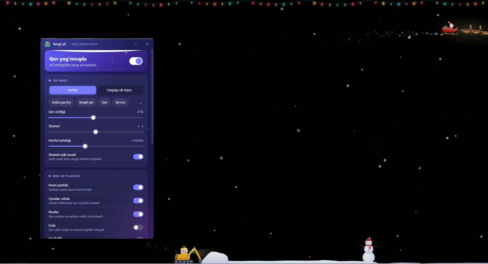

<p align="center"></p>

<h1 align="center">Let It Snow</h1>

<p align="center">
  Snow falls on your desktop, piles up on your windows and the taskbar (or the Dock on a Mac), a garland glows along the top,<br>
  Santa's sleigh flies by, a little excavator clears the snow, and you can build snowmen.
</p>

<p align="center">
  <a href="https://github.com/tasvirlab/let-it-snow/releases/latest/download/LetItSnow-Setup.exe"><b>⬇ Windows</b></a>
  &nbsp;·&nbsp;
  <a href="#install-on-mac"><b>⬇ Mac (Apple M &amp; Intel)</b></a>
  <br>
  <sub>Windows 10 / 11 · macOS 12 or later · free</sub>
</p>

<p align="center"></p>

<p align="center"><a href="#english">English</a> · <a href="#ozbekcha">O'zbekcha</a> · <a href="#русский">Русский</a></p>

---

## English

### What it does
- ❄️ **Snow** falls in three layers, with wind and gusts you can set yourself — or it follows the **real weather** in your city.
- 🏔 **Snow piles up** on top of your windows and at the bottom of the screen — on Windows along the whole taskbar, on a Mac right on top of the **Dock**, along its real length (it follows the Dock as apps open and close). Shake a window and its snow slides off; close or minimize it and the snow tumbles down. **Icicles** grow and drip.
- 🖱 **Sweep the snow** with your cursor. **Roll snowballs** and stack three into a **snowman** (right-click one to remove it). On a Mac they stand on the Dock — carry a ball off the Dock and it falls away.
- 🎄 A **garland** glows along the top (it hides when a window is maximized, so it never covers your buttons), **Santa's sleigh** flies by, and an **excavator** clears the snow when too much piles up (on a Mac it drives along the top of the Dock, from one end to the other).
- 🙈 It never gets in the way: clicks pass through the snow, and it hides by itself in full-screen games and videos.
- 🌐 English, Uzbek and Russian.

### Install on Windows
1. Download **[LetItSnow-Setup.exe](https://github.com/tasvirlab/let-it-snow/releases/latest/download/LetItSnow-Setup.exe)** and open it.
2. If Windows shows *"Windows protected your PC"*, click **More info → Run anyway**. (The app isn't signed with a paid certificate, that's all.)
3. That's it — it installs in a second and starts snowing. Look for the icon in the taskbar corner (next to the clock): **left-click** opens the settings, **right-click** opens the menu.

To remove it: **Settings → Apps → Let It Snow → Uninstall**.

### Install on Mac
**Easiest — one line (recommended).** Open **Terminal** (press ⌘ Space, type *Terminal*, press Enter), paste this line and press Enter:
```
curl -fsSL https://raw.githubusercontent.com/tasvirlab/let-it-snow/main/install-mac.sh | sh
```
It picks the right version for your Mac (Apple M or Intel), installs it into Applications and starts it — no security warnings.

<details><summary>Or install by hand from the .dmg</summary>

1. **Apple menu  → About This Mac**: if *Chip* says **Apple M…**, download [the Apple version](https://github.com/tasvirlab/let-it-snow/releases/latest/download/LetItSnow-mac-arm64.dmg); if **Intel**, download [the Intel version](https://github.com/tasvirlab/let-it-snow/releases/latest/download/LetItSnow-mac-x64.dmg).
2. Open the file and drag **Let It Snow** into **Applications**.
3. Because the app isn't notarized by Apple, macOS will say it *"is damaged"*. Open **Terminal** and run this once, then open the app:
   ```
   xattr -cr "/Applications/Let It Snow.app"
   ```
</details>

The app lives in the menu bar at the top of the screen. To remove it, drag it from Applications to the Trash.

**The Dock.** On first start the app asks for the **Accessibility** permission (*System Settings → Privacy & Security → Accessibility → Let It Snow*). It only reads where the Dock is and how long it is, so the snow sits exactly on it. If you say no, everything still works — the Dock size is estimated instead (minimized windows in the Dock aren't counted then). If the Dock is set to hide automatically or sits on the left or right, there is no snow at the bottom — flakes just fall past the screen edge. After updating the app, macOS may ask for the permission again.

---

## O'zbekcha

### Nima qiladi
- ❄️ Ish stolingizda **qor yog'adi**: uch qavat qor parchalari, shamol va shamol to'lqinlarini o'zingiz sozlaysiz yoki qor shahringizdagi **haqiqiy ob-havoga** moslashadi.
- 🏔 **Qor to'planadi** — oynalar ustida va ekran pastida: Windows'da butun taskbar bo'ylab, Mac'da aynan **Dock** ustida, uning haqiqiy uzunligi bo'ylab (ilovalar ochilib-yopilganda Dock bilan birga o'zgaradi). Oynani silkitsangiz qor sirg'alib tushadi, yopsangiz yoki kichraytirsangiz — qulab tushadi. **Sumalaklar** o'sib, tomchilaydi.
- 🖱 Sichqoncha bilan **qorni supurib tashlang**. **Qor to'pini dumalating** va uchtasini ustma-ust qo'yib **qordan odam** yasang (o'ng tugma bilan bossangiz yo'qoladi). Mac'da ular Dock ustida turadi — to'pni Dock'dan tashqariga olib chiqsangiz, pastga tushib ketadi.
- 🎄 Ekran tepasida **girlyanda** yonadi (oyna kattalashtirilsa, tugmalarga xalaqit bermaslik uchun yashirinadi), **Qorboboning chanasi** uchib o'tadi, qor ko'payib ketsa **ekskavator** kelib tozalaydi (Mac'da Dock ustidan bir chetidan ikkinchi chetigacha yurib o'tadi).
- 🙈 Hech narsaga xalaqit bermaydi: sichqoncha qor orqali bemalol bosiladi, to'liq ekranli o'yin yoki videoda qor o'zi yashirinadi.
- 🌐 O'zbek, ingliz va rus tillarida.

### Windows'ga o'rnatish
1. **[LetItSnow-Setup.exe](https://github.com/tasvirlab/let-it-snow/releases/latest/download/LetItSnow-Setup.exe)** faylini yuklab oling va oching.
2. Agar Windows *"Windows protected your PC"* desa, **More info → Run anyway** ni bosing. (Dasturda pullik imzo yo'q, xolos.)
3. Tamom — bir soniyada o'rnatiladi va qor yog'a boshlaydi. Belgisi taskbar burchagida, soat yonida: **chap tugma** — sozlamalar, **o'ng tugma** — menyu.

O'chirish: **Sozlamalar → Ilovalar → Let It Snow → Uninstall**.

### Mac'ga o'rnatish
**Eng oson yo'l — bitta qator (tavsiya etiladi).** **Terminal** ni oching (⌘ Space bosing, *Terminal* deb yozing, Enter), shu qatorni qo'ying va Enter bosing:
```
curl -fsSL https://raw.githubusercontent.com/tasvirlab/let-it-snow/main/install-mac.sh | sh
```
U Mac'ingizga mos versiyani (Apple M yoki Intel) o'zi tanlaydi, Applications papkasiga o'rnatadi va ishga tushiradi — hech qanday ogohlantirishsiz.

<details><summary>Yoki .dmg fayldan qo'lda o'rnatish</summary>

1. **Apple menyusi  → About This Mac**: *Chip* qatorida **Apple M…** bo'lsa — [Apple versiyasini](https://github.com/tasvirlab/let-it-snow/releases/latest/download/LetItSnow-mac-arm64.dmg), **Intel** bo'lsa — [Intel versiyasini](https://github.com/tasvirlab/let-it-snow/releases/latest/download/LetItSnow-mac-x64.dmg) yuklab oling.
2. Faylni oching va **Let It Snow** ni **Applications** papkasiga sudrab tashlang.
3. Dastur Apple tomonidan notarizatsiya qilinmagani uchun macOS uni *"is damaged" (shikastlangan)* deydi. **Terminal** ni ochib bir marta shu buyruqni bajaring, keyin dasturni oching:
   ```
   xattr -cr "/Applications/Let It Snow.app"
   ```
</details>

Dastur ekran tepasidagi menyu qatorida turadi. O'chirish uchun uni Applications'dan Savatga (Trash) tashlang.

**Dock.** Birinchi ishga tushganda dastur **Accessibility** (Universal kirish) ruxsatini so'raydi (*System Settings → Privacy & Security → Accessibility → Let It Snow*). U faqat Dock qayerda va qancha uzunligini o'qiydi, shunda qor aynan uning ustida yotadi. Ruxsat bermasangiz ham hammasi ishlayveradi — Dock o'lchami taxminan hisoblanadi (bunda Dock'dagi kichraytirilgan oynalar hisobga olinmaydi). Dock avtomatik yashirinsa yoki chap/o'ng tomonda tursa, pastda qor to'planmaydi — parchalar ekran chetidan o'tib ketadi. Dastur yangilangandan keyin macOS ruxsatni qayta so'rashi mumkin.

---

## Русский

### Что умеет
- ❄️ На рабочем столе **идёт снег** в три слоя, с ветром и порывами — настраиваете сами, или снег повторяет **реальную погоду** в вашем городе.
- 🏔 **Снег копится** на окнах и внизу экрана: в Windows — по всей панели задач, на Mac — прямо на **Dock**, по его настоящей длине (меняется вместе с Dock, когда открываются и закрываются приложения). Встряхните окно — и снег соскользнёт, закройте или сверните — снег осыплется. Растут и капают **сосульки**.
- 🖱 **Сметайте снег** курсором. **Катайте снежки** и ставьте три друг на друга — получится **снеговик** (правый клик — убрать). На Mac они стоят на Dock — унесите снежок за край Dock, и он упадёт.
- 🎄 Сверху горит **гирлянда** (прячется, когда окно развёрнуто, чтобы не закрывать кнопки), пролетают **сани Деда Мороза**, а **экскаватор** убирает снег, когда его становится много (на Mac он проезжает по верху Dock от края до края).
- 🙈 Ничему не мешает: клики проходят сквозь снег, а в полноэкранных играх и видео снег прячется сам.
- 🌐 Русский, английский и узбекский языки.

### Установка на Windows
1. Скачайте **[LetItSnow-Setup.exe](https://github.com/tasvirlab/let-it-snow/releases/latest/download/LetItSnow-Setup.exe)** и откройте.
2. Если Windows пишет *«Система Windows защитила ваш компьютер»*, нажмите **Подробнее → Выполнить в любом случае**. (У программы просто нет платной подписи.)
3. Готово — установка занимает секунду, и сразу идёт снег. Значок — в углу панели задач, рядом с часами: **левый клик** — настройки, **правый клик** — меню.

Удалить: **Параметры → Приложения → Let It Snow → Удалить**.

### Установка на Mac
**Проще всего — одна строка (рекомендуется).** Откройте **Терминал** (нажмите ⌘ Пробел, наберите *Терминал* или *Terminal*, Enter), вставьте эту строку и нажмите Enter:
```
curl -fsSL https://raw.githubusercontent.com/tasvirlab/let-it-snow/main/install-mac.sh | sh
```
Скрипт сам выберет версию для вашего Mac (Apple M или Intel), установит её в «Программы» и запустит — без предупреждений безопасности.

<details><summary>Или вручную из .dmg</summary>

1. **Меню Apple  → Об этом Mac**: если в строке *Чип* написано **Apple M…** — скачайте [версию для Apple](https://github.com/tasvirlab/let-it-snow/releases/latest/download/LetItSnow-mac-arm64.dmg), если **Intel** — [версию для Intel](https://github.com/tasvirlab/let-it-snow/releases/latest/download/LetItSnow-mac-x64.dmg).
2. Откройте файл и перетащите **Let It Snow** в **Программы (Applications)**.
3. Приложение не заверено Apple, поэтому macOS скажет, что оно *«повреждено»*. Откройте **Терминал**, выполните один раз эту команду и запустите приложение:
   ```
   xattr -cr "/Applications/Let It Snow.app"
   ```
</details>

Приложение живёт в строке меню вверху экрана. Чтобы удалить, перетащите его из «Программ» в Корзину.

**Dock.** При первом запуске приложение попросит разрешение **«Универсальный доступ»** (*Системные настройки → Конфиденциальность и безопасность → Универсальный доступ → Let It Snow*). Оно читает только положение и длину Dock, чтобы снег лежал точно на нём. Если не разрешить, всё равно работает — размер Dock вычисляется приблизительно (свёрнутые в Dock окна тогда не учитываются). Если Dock скрывается автоматически или стоит слева или справа, внизу снег не копится — снежинки просто падают за край экрана. После обновления macOS может спросить разрешение снова.

---

<sub>For developers: `npm install`, then `npm start`. Pushing a tag like `v1.0.2` builds the Windows and Mac installers with GitHub Actions and publishes them as a release.</sub>
